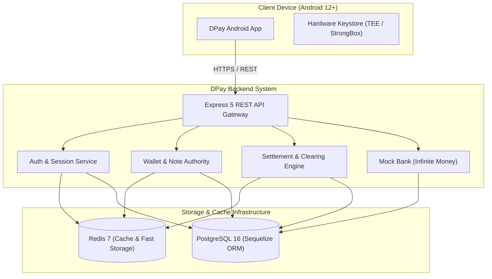
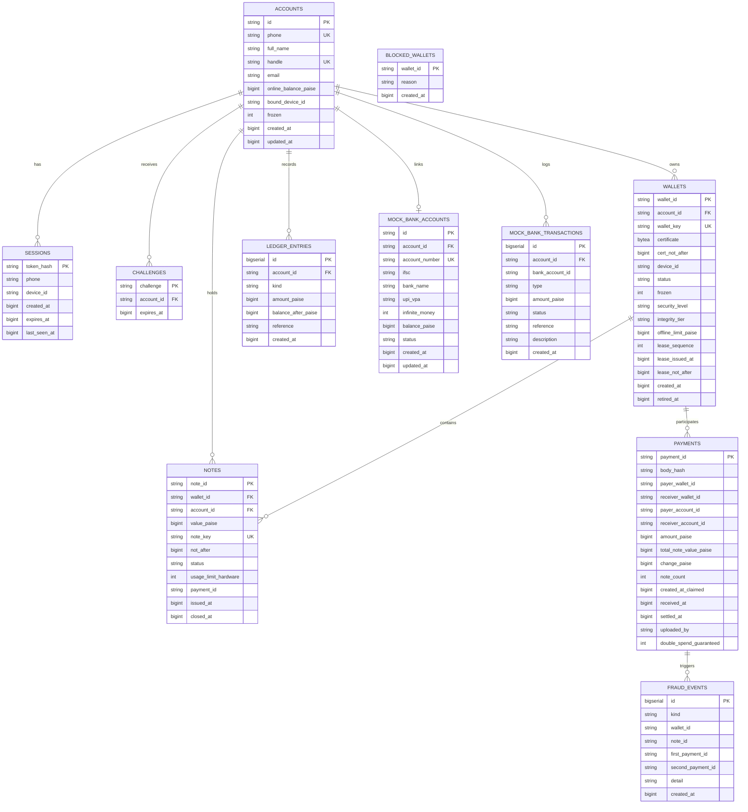
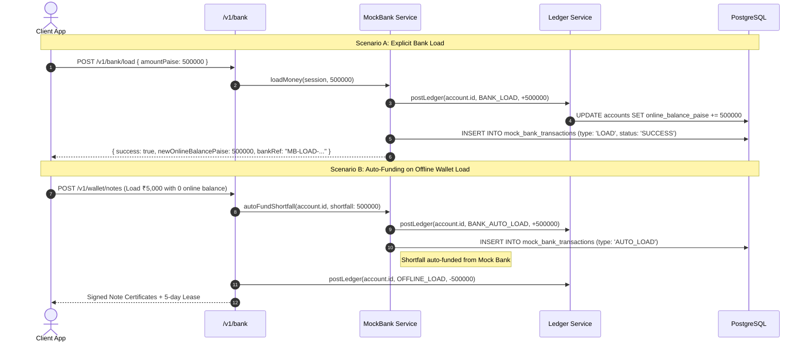
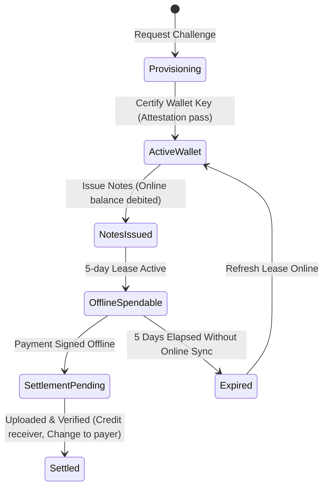
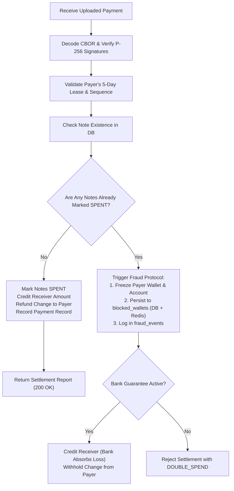

# DPay Backend Architecture & Design Document (For Agents & Engineers)

> **Audience**: Autonomous AI agents, backend software engineers, and cryptographic protocol architects working on the DPay banking backend.
> **Status**: Implemented & Active
> **Version**: 1.0.0
> **Runtime**: Node.js 22.13+ (Native ESM, TypeScript Type Stripping)
> **Database**: PostgreSQL 16+ via Sequelize ORM
> **Fast Storage & Cache**: Redis 7+ (`ioredis`)

---

## 1. System Mission & Context

DPay is an offline-first peer-to-peer digital payments system designed to enable real-world monetary exchange without cellular or internet connectivity at point-of-sale. 

The `dpay-backend` serves as the centralized trust anchor, bank ledger, certificate authority, and clearing house. It operates on a **dual-rail financial model**:
1. **Online Ledger Rail**: Real-time accounts denominated in integer paise (1 INR = 100 paise), backed by double-entry transactional ledger records.
2. **Offline Cryptographic Cash Rail**: Bearer-token cash notes signed by the bank's issuer key, cryptographically bounded by hardware-backed asymmetric keys on user devices (Android Keystore / StrongBox / TEE) and governed by strict **5-day wallet leases**.



---

## 2. Architecture & Tech Stack

| Layer | Technology | Purpose |
|---|---|---|
| **Runtime** | Node.js `>=22.13` | Native ESM with `--experimental-strip-types` (no build step in dev). |
| **HTTP Framework** | Express `^5.1.0` | Async route handling, JSON parsing up to 5 MB for batch settlement payloads. |
| **Security & Middleware** | `helmet`, `cors`, `express-rate-limit` | HTTP headers hardening, origin filtering, endpoint rate limiting. |
| **ORM / Database** | Sequelize `^6.37.8` + PostgreSQL 16 | Relational persistence, transactions, and migration schemas. |
| **Fast Storage / Cache** | Redis 7 + `ioredis` | Sub-millisecond session authentication, OTP caching, single-use challenge consumption, and blocklist queries. |
| **Validation** | `zod ^4.1.0` | Strict contract validation on HTTP wire boundaries. |
| **Cryptography** | Node.js `node:crypto` | NIST P-256 (secp256r1) signing, verification, SHA-256 digests, and HMAC-SHA256 OTP hashing. |
| **Serialization** | Strict Canonical CBOR (RFC 8949) | Deterministic, canonical binary wire encoding for certificates, notes, and leases. |

---

## 3. Database Schema & Models (Sequelize)

All monetary amounts are represented as **64-bit integer paise** (`BIGINT` in PostgreSQL, configured to parse automatically into JavaScript `Number` up to $2^{53} - 1$). Float/decimal values are strictly forbidden in monetary arithmetic.



---

## 4. Redis Fast Storage & Caching Layer

Redis acts as the high-throughput, low-latency acceleration layer and ephemeral state coordinator:

```
┌────────────────────────────────────────────────────────────────────────┐
│                              REDIS CACHE                               │
├──────────────────────┬────────────────────────┬────────────────────────┤
│ Key Pattern          │ Type / Value           │ TTL / Purpose          │
├──────────────────────┼────────────────────────┼────────────────────────┤
│ session:<tokenHash>  │ JSON (CachedSession)   │ SESSION_TTL_DAYS (30d) │
│                      │ { phone, deviceId, … } │ Sub-millisecond auth   │
├──────────────────────┼────────────────────────┼────────────────────────┤
│ otp:<phone>          │ JSON (CachedOtp)       │ 5 minutes (OTP_TTL)    │
│                      │ { codeHash, attempts } │ Immediate verification │
├──────────────────────┼────────────────────────┼────────────────────────┤
│ challenge:<hex>      │ String (accountId)     │ 5 minutes              │
│                      │                        │ Atomic GETDEL access   │
├──────────────────────┼────────────────────────┼────────────────────────┤
│ blocked_wallets      │ Set of walletIdHex     │ Permanent set          │
│                      │                        │ O(1) SISMEMBER checks  │
├──────────────────────┼────────────────────────┼────────────────────────┤
│ lock:<resource>      │ String (random token)  │ Configurable (ms)      │
│                      │                        │ Distributed lock       │
└──────────────────────┴────────────────────────┴────────────────────────┘
```

### Invalidation Strategy
- **Device Move**: When an account binds to a new device (`moveToThisDevice`), the backend fetches all session tokens for the phone associated with older device IDs, issues `del session:<tokenHash>` on Redis, and deletes them from PostgreSQL.
- **Challenge Consumption**: Single-use attestation challenges are fetched and consumed atomically using Redis `GETDEL` (falling back to database consumption if unavailable).
- **Fraud Blocklisting**: Whenever a double-spend is proven, the offending wallet is persisted to `blocked_wallets` in PostgreSQL and concurrently added to the Redis `blocked_wallets` set (`SADD`).

---

## 5. Central Bank Simulator & Infinite Money Engine

> [!NOTE]
> **Production Boundary**: The Central Bank simulator (`src/services/mockBank.ts`, mounted at `/v1/bank` and `/v1/central-bank`) is the **ONLY** faked component in the DPay backend. It models the external interbank clearing house (e.g. Reserve Bank of India / NPCI settlement network) to provide infinite fiat liquidity and bank linkages. All other backend subsystems (Authentication, Attestation, Wallets, 5-day Leases, Notes, Double-Spend Detection, Double-Entry Ledger, and Administration) are production-ready.

To facilitate testing and instant settlement without requiring external sovereign bank APIs, the backend embeds this **Central Bank Simulator**:



### Core Mock Bank Behaviors
1. **Provisioning on Registration**: Whenever a new user completes profile registration, a linked mock bank account (`DPay Reserve Bank`, IFSC `DPAY0000001`, A/C `100<phone>`, VPA `<handle>@mockbank`) is automatically created with infinite liquidity.
2. **Infinite Money Guarantee**: Loads (`POST /v1/bank/load`) are unconditionally granted.
3. **Automatic Shortfall Coverage**: If `MOCK_BANK_AUTO_LOAD=true` (enabled by default outside production), any offline load request that exceeds the user's available online balance will auto-fund the difference from the mock bank rather than rejecting with `INSUFFICIENT_BALANCE`.
4. **Settlement Sweep / Withdrawal**: Users can settle / withdraw online funds back to their mock bank account (`POST /v1/bank/withdraw`), updating the double-entry ledger with `BANK_WITHDRAW`.

---

## 6. Cryptographic Protocol & Offline Money Lifecycle

### 6.1 Cryptographic Primitives
- **Curve**: NIST P-256 (`prime256v1` / `secp256r1`).
- **Keys**: All public keys are transmitted and stored in **compressed 33-byte format** (`02` or `03` prefix + 32-byte X coordinate).
- **Signatures**: ASN.1 DER encoded ECDSA signatures over SHA-256 digests.
- **Signing Domain Separation**: Every signature is computed with a specific domain-separator prefix:
  - `DPAY-WALLET-CERT-V1`
  - `DPAY-NOTE-CERT-V1`
  - `DPAY-LEASE-V1`
  - `DPAY-SPEND-V1`

### 6.2 Denomination Architecture
The backend enforces whole-rupee offline loading capped at ₹5,000 per wallet. The offline notes must strictly match `DenominationPlanner.plan(total)`:
- Standard ₹5,000 load decomposes into exactly **15 notes**:
  `[1000, 1000, 1000, 500, 500, 200, 200, 200, 100, 100, 90, 50, 20, 20, 20]` (in paise: ₹10, ₹5, ₹2, ₹1 sub-notes).
- Every whole-rupee amount from ₹1 to ₹5,000 can be paid exactly without requiring real-time change generation from the receiver.

### 6.3 Five-Day Leases (`WalletLease`)
An offline wallet can only sign payments if it possesses a valid lease signed by the bank.
- **Lease Expiry**: Maximum 5 days (432,000 seconds).
- **Strictly Increasing Sequence**: Every new lease increments `lease_sequence`.
- **Ledger Digest**: The lease contains a cryptographic commitment (SHA-256) over all unspent, unexpired note IDs currently issued to that wallet.



---

## 7. Settlement & Double-Spend Resolution

When offline payments are uploaded (`POST /v1/settlement`), the server performs atomic verification:



---

## 8. API Specifications & Route Catalog

> [!TIP]
> **Interactive Swagger UI**: Available at `/docs` (or `/api-docs`). The machine-readable OpenAPI 3.1 specification is hosted at `/docs/openapi.json` and `/docs/openapi.yaml`, and tracked statically in [`docs/openapi.yaml`](./openapi.yaml) and [`docs/openapi.json`](./openapi.json).

### 8.1 Authentication (`/v1/auth`)
- `POST /v1/auth/otp`: Initiate phone verification. Returns challenge TTL and resend window.
- `POST /v1/auth/otp/verify`: Submits 6-digit code with device ID. Returns bearer session token.
- `POST /v1/auth/logout` *(Bearer token required)*: Revokes session in PostgreSQL and Redis.

### 8.2 Profile & Handles (`/v1/profile`, `/v1/handles`, `/v1/device`)
- `GET /v1/handles/availability?handle=name@dpay`: Checks handle availability.
- `GET /v1/handles/suggestion?fullName=John%20Doe`: Suggests handle candidates.
- `POST /v1/profile` *(Bearer)*: Creates user account and links Mock Bank account.
- `GET /v1/profile` *(Bearer)*: Retrieves user profile details.
- `PATCH /v1/profile` *(Bearer)*: Updates user profile.
- `POST /v1/device/move` *(Bearer)*: Re-binds account to new device, invalidates old sessions and retires previous wallet.

### 8.3 Provisioning & Wallet (`/v1/provisioning`, `/v1/wallet`)
- `POST /v1/provisioning/challenge` *(Bearer)*: Generates single-use attestation challenge.
- `POST /v1/wallet/certificate` *(Bearer)*: Verifies identity key attestation & Play Integrity, issues signed wallet certificate.
- `POST /v1/wallet/notes` *(Bearer)*: Issues note certificates matching denomination plan, creates new 5-day lease, auto-funds shortfall if infinite money is enabled.
- `POST /v1/wallet/lease` *(Bearer)*: Refreshes 5-day lease for active notes.
- `GET /v1/wallet` *(Bearer)*: Returns wallet status, active lease, and held notes.

### 8.4 Settlement & History (`/v1/settlement`, `/v1/payments`, `/v1/transactions`)
- `POST /v1/settlement` *(Bearer)*: Batch uploads received and sent payments for settlement.
- `GET /v1/payments/:paymentId` *(Bearer)*: Queries settlement status of a specific payment.
- `GET /v1/account` *(Bearer)*: Returns online balance and outstanding offline note totals.
- `GET /v1/transactions` *(Bearer)*: Cursor-paginated online ledger history.
- `GET /v1/blocklist` *(Bearer)*: Retrieves list of double-spending blocked wallets.

### 8.5 Central Bank Simulator & Liquidity (`/v1/bank`, `/v1/central-bank`)
*(The only simulated service; models RBI / interbank clearing)*
- `GET /v1/bank/account` or `GET /v1/central-bank/account` *(Bearer)*: Retrieves linked central bank account number, IFSC, online balance, and infinite liquidity status.
- `POST /v1/bank/load` or `POST /v1/central-bank/load` *(Bearer)*: Loads money from central bank into DPay online balance (`{ amountPaise, reference? }`).
- `POST /v1/bank/withdraw` or `POST /v1/central-bank/withdraw` *(Bearer)*: Sweeps / settles online balance back to central bank account (`{ amountPaise, reference? }`).
- `GET /v1/bank/transactions` or `GET /v1/central-bank/transactions` *(Bearer)*: Transaction history of central bank loads and settlement sweeps.

### 8.6 Back-Office Administration (`/v1/admin`)
*(Requires `X-Admin-Key` header matching `ADMIN_API_KEY`)*
- `POST /v1/admin/accounts/:phone/credit`: Credits online balance.
- `POST /v1/admin/accounts/:phone/freeze`: Freezes account.
- `POST /v1/admin/accounts/:phone/unfreeze`: Unfreezes account.
- `GET /v1/admin/fraud-events`: Inspects detected double-spend attempts.
- `POST /v1/admin/maintenance`: Manually triggers note expiry refunds and session cleanup.

### 8.7 Health & Production Probes
- `GET /health`: Liveness probe (HTTP 200 `{ status: "ok", service: "dpay-backend", uptimeSeconds, time }`).
- `GET /health/ready`: Readiness probe (HTTP 200 `{ status: "ready", checks: { database: "up", redis: "up", issuerKey: "loaded" } }` or HTTP 503 if any dependency fails).

---

## 9. Invariant Rules for Autonomous Agents

When modifying or extending the backend codebase, agents MUST uphold these invariant rules:

1. **Transactional Integrity**: Every financial state modification (ledger posts, note state changes, session invalidations) MUST execute inside `ctx.db.transaction(async () => { ... })`.
2. **Never Overdraw Online Accounts**: The check constraint `CHECK (online_balance_paise >= 0)` is strictly enforced in PostgreSQL and in the ledger module.
3. **Debit-Before-Signing**: In offline note issuance, online balance MUST be debited before any note certificate or lease is signed.
4. **Denomination Plan Strictness**: Never issue notes that deviate from `planDenominations(total)`.
5. **Cache-Store Consistency**: Whenever sessions or challenges are removed or modified in PostgreSQL, the corresponding Redis key (`session:<tokenHash>`, `otp:<phone>`) MUST be purged or synchronized.
6. **No Float Arithmetic**: All money logic must operate strictly on integer paise. Do not introduce fractional rupees in database queries or domain calculations.

